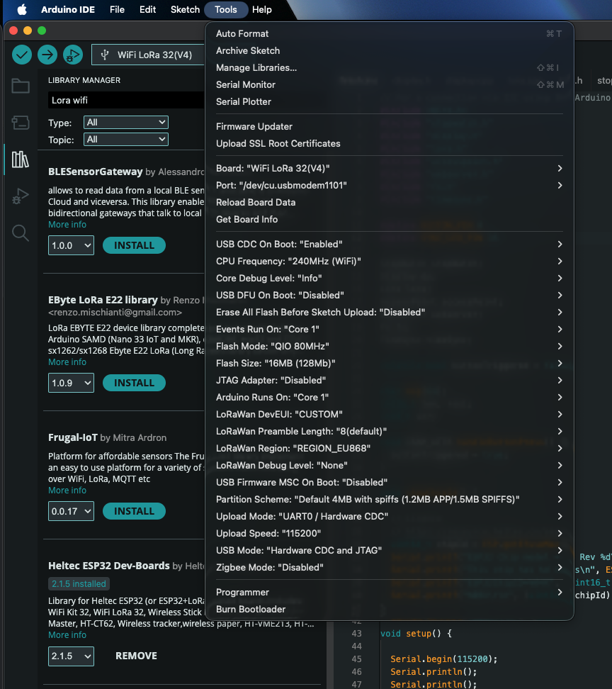

# ski-timing

## Setup

### Arduino IDE

Download and install https://www.arduino.cc/en/software/

Unter preferences, add following URLs under  the "Additional Boards Manager URLs"
- https://resource.heltec.cn/download/package_heltec_esp32_index.json
- (optional) https://dl.espressif.com/dl/package_esp32_index.json

Under Library Manager, install following libraries
- Heltec ESP32 Dev-Boards


Select the right Board and settings under Tools (see image)




### esptool

Sometimes it is necessary to reset or reflash the firmware using esptool.

Download and install https://github.com/espressif/esptool/releases

To run and reset the board runn following:

```bash 
### /dev/cu.usbmodem1101 is the port of the board, check your system for the right one
./esptool --no-stub --port /dev/cu.usbmodem1101 flash-id
```
